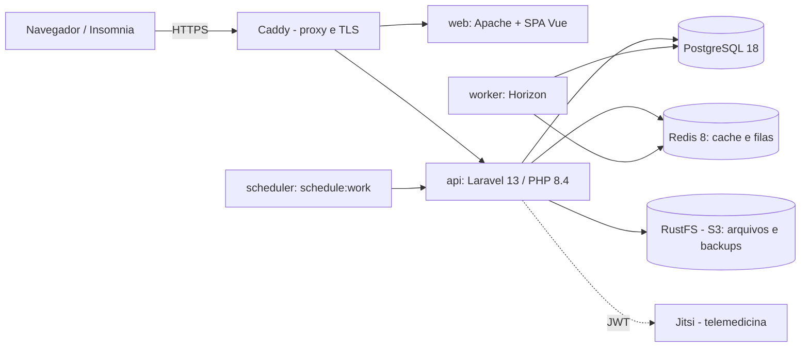

# 🏥 SGHSS VidaPlus

**Sistema de Gestão Hospitalar e de Serviços de Saúde** — API REST (Laravel) + SPA (Vue 3)

*Projeto Multidisciplinar · Análise e Desenvolvimento de Sistemas · ênfase Back-end*

[](https://github.com/olwr/sghss-vidaplus/actions/workflows/backend-ci.yml)
[](https://github.com/olwr/sghss-vidaplus/actions/workflows/frontend-ci.yml)
[](https://github.com/olwr/sghss-vidaplus/actions/workflows/cd-images.yml)
-85%25-brightgreen)

[](https://wakatime.com/badge/github/olwr/sghss-vidaplus)


> [!NOTE]
> **Para o corretor/avaliador:** vá direto para [5. Como executar](#5-como-executar) e [7. Como testar a API](#7-como-testar-a-api-scramble-e-insomnia). Em **~10 minutos** você sobe o sistema, entra com os 4 perfis e testa os endpoints. Os usuários e a senha de demonstração estão em [2.3](#23-as-4-personas-usuários-de-demonstração).

---

## Sumário

1. [Sobre o projeto](#1-sobre-o-projeto)
2. [Usuários do sistema (as 4 personas)](#2-usuários-do-sistema-as-4-personas)
3. [Arquitetura](#3-arquitetura)
4. [Pré-requisitos](#4-pré-requisitos)
5. [Como executar](#5-como-executar) — [dev](#51-ambiente-de-desenvolvimento-localdev) · [produção local](#52-ambiente-de-produção-local-localprod) · [**Windows (com e sem WSL)**](#53-windows-com-e-sem-wsl)
6. [Como testar o sistema](#6-como-testar-o-sistema)
7. [Como testar a API (Scramble e Insomnia)](#7-como-testar-a-api-scramble-e-insomnia)
8. [Erros comuns e como corrigir](#8-erros-comuns-e-como-corrigir)
9. [Comandos úteis](#9-comandos-úteis)
10. [Qualidade, CI/CD e convenções](#10-qualidade-cicd-e-convenções)
11. [Documentação complementar](#11-documentação-complementar)
12. [Autoria e licença](#12-autoria-e-licença)

---

## 1. Sobre o projeto

### 1.1 Contexto

A **VidaPlus** é uma rede de saúde com **hospitais, clínicas, laboratórios e serviços de *home care***. Hoje cada unidade trabalha com processos e registros próprios, o que dificulta agendar consultas, consultar prontuários, controlar leitos e suprimentos e provar conformidade com a **LGPD**.

### 1.2 Objetivo

Entregar o **SGHSS**: uma plataforma única que centraliza cadastro de pacientes e profissionais, agendamento, prontuário eletrônico, receitas e exames, **telemedicina**, internações/leitos, suprimentos, relatórios e **auditoria**, com segurança e privacidade como requisitos de primeira classe.

Como a ênfase do trabalho é **Back-end**, o núcleo é uma **API REST versionada (`/api/v1`)** documentada em OpenAPI e coberta por testes automatizados. O **front-end (Vue 3)** é um MVP funcional (login, portal do paciente com agendamento em 5 passos, acessibilidade e responsividade).

### 1.3 O que o sistema faz

| Módulo                      | O que entrega                                                |
| --------------------------- | ------------------------------------------------------------ |
| **Segurança**               | Login com token (Sanctum), perfis e permissões (RBAC), sessão de 60 min, limite de tentativas de login, revogação de sessões |
| **Unidades**                | Hospitais, clínicas, laboratórios e home care; status (ativa, em reforma, em recesso, desativada) |
| **Pacientes**               | Cadastro com **CPF cifrado + índice cego** (busca por CPF sem expor o dado), autocadastro, equipe de cuidado |
| **Profissionais e equipes** | Cadastro com conselho profissional (CRM etc.), equipes e transferências entre unidades |
| **Agenda**                  | Grades de horário, **disponibilidade**, agendamento **idempotente** (`Idempotency-Key`), confirmar, remarcar, cancelar, falta, início e conclusão |
| **Prontuário**              | Prontuário eletrônico, registros clínicos, **receitas** (PDF), **exames** e resultados |
| **Telemedicina**            | Sala de vídeo (Jitsi) com **JWT** e janela de entrada (antecedência/tolerância) |
| **Internações**             | Leitos, solicitação/admissão/alta/cancelamento, **suprimentos** com movimentação de estoque |
| **Relatórios**              | Consultas, ocupação de leitos, internações, financeiro e estoque crítico; **exportação assíncrona** (XLSX/PDF) |
| **LGPD e auditoria**        | Consentimentos, exportação dos próprios dados, anonimização, **log de auditoria imutável**, relatório de conformidade |
| **Operação**                | Backup diário criptografado, **teste automático de restauração**, `GET /api/v1/saude`, sonda de disponibilidade (meta 99,5 %) |

---

## 2. Usuários do sistema (as 4 personas)

### 2.1 Visão geral

O estudo de caso usa quatro personas. Cada uma corresponde a um **perfil** com permissões diferentes (princípio do menor privilégio).

| Persona               | Perfil               | Papel na VidaPlus            | O que pode fazer                                             | O que **não** pode                                           |
| --------------------- | -------------------- | ---------------------------- | ------------------------------------------------------------ | ------------------------------------------------------------ |
| **Ana Maria Pereira** | `paciente`           | Paciente do Hospital Central | Ver e gerenciar os **próprios** dados, agendar/cancelar consultas, ver receitas e exames, gerenciar consentimentos (LGPD) | Ver outros pacientes, listar unidades, qualquer área administrativa |
| **Renato Lima**       | `secretario`         | Recepção do Hospital Central | Cadastrar pacientes, agendar/confirmar/remarcar consultas    | Acessar prontuário clínico, criar unidades                   |
| **Dra. Camila Rocha** | `profissional_saude` | Médica (Clínica Geral)       | Prontuário, registros clínicos, receitas, exames, conduzir atendimento e telemedicina | Funções administrativas (usuários, relatórios)               |
| **Alan Souza**        | `administrador`      | TI/gestão da rede            | Unidades, usuários, profissionais, leitos, suprimentos, relatórios, auditoria, LGPD | **Acesso clínico** (prontuário, receitas, exames): propositalmente bloqueado |

> [!IMPORTANT]
> O administrador **não** tem permissões clínicas: quem administra o sistema não lê prontuários. Ao testar, um **403** no prontuário com o perfil Administrador é o resultado **correto**.

### 2.2 Escopo por unidade

Secretário, profissional e paciente enxergam apenas dados da **própria unidade** (escopo aplicado no banco por `UnidadeScope`). O administrador tem visão da rede.

### 2.3 As 4 personas (usuários de demonstração)

Criados pelo `DemoSeeder` (**somente em dev/local**; o seeder se recusa a rodar em produção real).

| Perfil                | E-mail                 | Senha                    |
| --------------------- | ---------------------- | ------------------------ |
| Administrador         | `alan@vidaplus.test`   | valor de `DEMO_PASSWORD` |
| Secretário            | `renato@vidaplus.test` | valor de `DEMO_PASSWORD` |
| Profissional de saúde | `camila@vidaplus.test` | valor de `DEMO_PASSWORD` |
| Paciente              | `ana@vidaplus.test`    | valor de `DEMO_PASSWORD` |

A senha padrão de demonstração está em `backend/.env.example` (`DEMO_PASSWORD="demo@passwrd#2026"`). **Nunca use essa senha fora da demonstração.**

---

## 3. Arquitetura

### 3.1 Visão geral



Em **desenvolvimento** não há Caddy: a API responde direto em `:8000` e o front roda no Vite em `:5173`. Em **produção** só o Caddy publica portas (80/443).

### 3.2 Back-end: monólito modular em camadas

Um único deploy, dividido por **domínios** (`app/Domains/*`) e um núcleo comum (`app/Shared`). Cada requisição segue o mesmo caminho:

```
Rota → Middleware (auth:sanctum, can:permissão) → Controller (fino)
     → Form Request (validação) → Service (regra de negócio)
     → Model/PostgreSQL → API Resource (saída)
```

Domínios: `Seguranca`, `Unidades`, `Pacientes`, `Profissionais`, `Agendamentos`, `Prontuarios`, `Telemedicina`, `Internacoes`, `Transferencias`, `Relatorios`, `Administracao`. Em `Shared`: auditoria, backup, enums, exceções, escopos, suporte (`ProblemDetails`).

### 3.3 Decisões de projeto que valem conhecer

| Decisão                                                      | Por quê                                                      |
| ------------------------------------------------------------ | ------------------------------------------------------------ |
| **Erros em RFC 7807** (`application/problem+json`)           | Resposta de erro padronizada e previsível para qualquer cliente |
| **Identificadores UUID** nas URLs                            | Não expõe contagem/ordem de registros; id inválido responde 404 |
| **Agendamento idempotente**                                  | Clique duplo ou retry de rede não gera duas consultas (`Idempotency-Key`) |
| **Sem sobreposição de horários** (restrição de exclusão no PostgreSQL) | A regra vale mesmo com concorrência, não só na aplicação     |
| **CPF cifrado + índice cego (HMAC)**                         | Busca por CPF sem guardar o CPF em claro (LGPD)              |
| **Auditoria append-only**                                    | Gatilho no banco impede alterar/apagar registros de auditoria |
| **Sessão só em memória no front + logout por inatividade (15 min)** | Reduz risco de sessão esquecida em computador compartilhado  |
| **CSP restritiva no site**                                   | Sem `unsafe-inline`/`unsafe-eval`; testada no navegador (E2E) |
| **Imagens separadas dev × prod**                             | Prod sem Xdebug, sem código montado, `APP_DEBUG=false`       |

### 3.4 Pilha tecnológica

| Camada        | Tecnologias                                                  |
| ------------- | ------------------------------------------------------------ |
| Back-end      | PHP 8.4, Laravel 13, Sanctum, Spatie Permission/Activitylog/Backup, Horizon, Scramble (OpenAPI), DomPDF, Maatwebsite Excel |
| Banco e infra | PostgreSQL 18, Redis 8, RustFS (S3-compatível), Mailpit (e-mail em dev), Docker Compose, Caddy |
| Front-end     | Vue 3.5, TypeScript, Vite, Pinia, Vue Router, Tailwind 4, Axios, Zod + VeeValidate, Chart.js |
| Qualidade     | PHPUnit 12, Larastan, Pint (PSR-12), Vitest, Playwright + axe-core, pcov |
| Entrega       | GitHub Actions (CI e publicação de imagens no GHCR), Dependabot, Conventional Commits |

### 3.5 Estrutura do repositório

```
sghss-vidaplus/
├── backend/                  # API Laravel (app/Domains, app/Shared, database, routes/api/v1, tests)
├── frontend/                 # SPA Vue 3 (src, e2e, Dockerfile, docker/httpd-spa.conf)
├── docker/Caddyfile          # proxy e TLS (produção)
├── docker-compose.yml        # ambiente de desenvolvimento
├── docker-compose.prod.yml   # sobreposição de produção
├── docker-compose.prod-local.yml  # produção rodando no seu computador
├── docs/                     # DBML/diagramas, OpenAPI, coleção Insomnia, evidências
├── scripts/                  # verificação de segredos/segurança, sonda de disponibilidade
├── .github/                  # workflows de CI/CD e Dependabot
├── .githooks/                # commit-msg (Conventional Commits)
└── .env.example              # variáveis do Compose (raiz)
```

O modelo de dados (26 tabelas) está em `docs/db/` (DBML e diagramas).

---

## 4. Pré-requisitos

| Item                    | Versão                                                       | Observação                                                   |
| ----------------------- | ------------------------------------------------------------ | ------------------------------------------------------------ |
| **Docker** + Compose v2 | recente                                                      | Obrigatório. **Windows:** Docker Desktop (motor **WSL2** ou **Hyper-V**); ver [5.3](#53-windows-com-e-sem-wsl) |
| **Git**                 | qualquer                                                     | Para clonar. No Windows, o **Git para Windows** inclui o **Git Bash** (necessário para os `scripts/*.sh`) |
| **Node.js**             | LTS (22+)                                                    | Só para rodar o front em dev (`npm run dev`) e os testes do front |
| **Portas livres**       | `8000`, `5173`, `5432`, `6379`*, `8025`, `9000/9001` (dev) · `80` e `443` (prod local) | *Redis não publica porta no host                             |

> Não é necessário ter PHP, Composer nem PostgreSQL instalados: tudo roda em contêineres.
>
> **Caminhos suportados:** (1) **WSL2 + Docker** (desenvolvido e testado assim), (2) Linux/macOS e (3) **Windows puro** (PowerShell/Git Bash + Docker Desktop), descrito em [5.3](#53-windows-com-e-sem-wsl). Os comandos das seções 5.1, 5.2 e 9 são em **bash**.

---

## 5. Como executar

### 5.1 Ambiente de desenvolvimento (local/dev)

**1) Clone e prepare os arquivos de ambiente**

```bash
git clone https://github.com/olwr/sghss-vidaplus.git
cd sghss-vidaplus

cp .env.example .env                    # variáveis do Compose (senhas de DEMONSTRAÇÃO)
cp backend/.env.example backend/.env    # configuração do Laravel
cp frontend/.env.example frontend/.env  # URL da API para o Vite
git config core.hooksPath .githooks     # (opcional) valida mensagens de commit
```

**2) Instale as dependências do back-end e suba os serviços**

```bash
docker compose build
docker compose run --rm --no-deps api composer install
docker compose up -d
docker compose ps        # tudo "running/healthy" (storage-init termina sozinho: Exited 0 é normal)
```

**3) Gere a chave, crie o banco e carregue os dados de demonstração**

```bash
docker compose exec api php artisan key:generate
docker compose exec api php artisan migrate:fresh --seed
```

> [!TIP]
> O `--seed` cria perfis, permissões e as **4 personas** com as **4 unidades** da VidaPlus. A senha delas é o `DEMO_PASSWORD` do `backend/.env`.

**4) Suba o front-end** (em outro terminal, no WSL/Linux/macOS com Node instalado)

```bash
cd frontend
npm ci
npm run dev             # http://localhost:5173
```

**5) Confira que está tudo no ar**

| O que                              | Endereço                            | Esperado                                 |
| ---------------------------------- | ----------------------------------- | ---------------------------------------- |
| Site (SPA)                         | http://localhost:5173               | tela de login                            |
| Saúde da API                       | http://localhost:8000/api/v1/saude  | JSON com `ok` por componente             |
| **Documentação da API (Scramble)** | http://localhost:8000/docs/api      | interface com todos os endpoints         |
| Contrato OpenAPI                   | http://localhost:8000/docs/api.json | JSON OpenAPI 3.1                         |
| E-mails de teste (Mailpit)         | http://localhost:8025               | caixa de entrada de dev                  |
| Console do armazenamento (RustFS)  | http://localhost:9001               | buckets `sghss-private`, `sghss-backups` |

Entre no site com `ana@vidaplus.test` (paciente) e a senha de demonstração.

> O serviço `web` (perfil `web`, porta `8081`) serve o **build de produção** do site só para validação: `docker compose --profile web up -d --build web`. Para desenvolver, use o `npm run dev`.

### 5.2 Ambiente de produção local (local/prod)

Executa a **mesma configuração de produção** (imagens `prod`, Caddy com TLS, `APP_DEBUG=false`, CSP/HSTS) no seu computador, **sem domínio e sem custo**. Usa o nome de projeto `sghss-prod`: volumes e contêineres **separados** do dev.

> [!WARNING]
> **Pare o ambiente de dev antes** (`docker compose down`, sem `-v`) para liberar as portas 80/443.

**1) Prepare os arquivos de ambiente de produção** (não são versionados)

```bash
cp .env.production.example .env.production
cp backend/.env.production.example backend/.env.production
```

Edite **os dois** arquivos. O que precisa **coincidir** entre eles:

| Onde                      | Variável                                                     | Valor para uso local                            |
| ------------------------- | ------------------------------------------------------------ | ----------------------------------------------- |
| `.env.production`         | `DOMINIO_SITE`                                               | `sghss.localhost`                               |
| `.env.production`         | `DOMINIO_API`                                                | `api.sghss.localhost`                           |
| `.env.production`         | `POSTGRES_PASSWORD`                                          | uma senha forte (ex.: `openssl rand -hex 16`)   |
| `backend/.env.production` | `DB_PASSWORD`                                                | **a mesma** `POSTGRES_PASSWORD`                 |
| `.env.production`         | `REDIS_PASSWORD`                                             | uma senha forte                                 |
| `backend/.env.production` | `REDIS_PASSWORD`                                             | **a mesma**                                     |
| `.env.production`         | `STORAGE_ACCESS_KEY` / `STORAGE_SECRET_KEY`                  | valores quaisquer                               |
| `backend/.env.production` | `AWS_ACCESS_KEY_ID` / `AWS_SECRET_ACCESS_KEY`                | **os mesmos** do storage                        |
| `backend/.env.production` | `APP_URL`                                                    | `https://api.sghss.localhost`                   |
| `backend/.env.production` | `FRONTEND_URL`                                               | `https://sghss.localhost` (**sem** barra final) |
| `backend/.env.production` | `APP_KEY`                                                    | gere com o comando abaixo                       |
| `backend/.env.production` | `BLIND_INDEX_KEY`, `BACKUP_ARCHIVE_PASSWORD`, `JITSI_APP_SECRET` | valores gerados (`openssl rand -base64 32`)     |
| `backend/.env.production` | `MAIL_MAILER`                                                | `log` (sem SMTP real)                           |

> [!CAUTION]
> Evite `#`, `$`, aspas e espaços nas senhas (`.env` trata `#` como comentário e o Compose interpola `$`). Sem linha de comentário depois do valor.

Gerar a `APP_KEY` (cole o resultado em `backend/.env.production`):

```bash
docker compose run --rm --no-deps api php artisan key:generate --show
```

**2) Defina o atalho do comando** (use sempre o completo, com `-p sghss-prod`)

```bash
P="docker compose -p sghss-prod -f docker-compose.yml -f docker-compose.prod.yml -f docker-compose.prod-local.yml --env-file .env.production"
$P config -q && echo "compose ok"
```

**3) Construa e suba** (a 1ª vez demora alguns minutos)

```bash
$P up -d --build
$P ps
```

> A linha `✘ Image sghss-api:local ... pull access denied` no início é **inofensiva**: o Compose tenta baixar a imagem antes de construí-la.

**4) Banco e dados**

```bash
$P exec api php artisan migrate --force
$P exec api php artisan db:seed --force        # produção: SÓ perfis e permissões
```

**5) Usuários de demonstração (opcional, só para avaliar)**

A imagem de produção **não** tem o Faker e o `DemoSeeder` **recusa** `APP_ENV=production` (de propósito). Para a demonstração local, rode o seeder pela imagem de desenvolvimento, **com as mesmas chaves** da produção (senão os dados cifrados não abrem no site):

```bash
v() { grep -m1 "^$1=" backend/.env.production | sed -E 's/^[^=]+=//; s/[[:space:]]+#.*$//; s/^"(.*)"$/\1/'; }
docker compose -p sghss-prod -f docker-compose.yml run --rm --no-deps \
  -e APP_ENV=local -e CACHE_STORE=array -e QUEUE_CONNECTION=sync \
  -e APP_KEY="$(v APP_KEY)" -e BLIND_INDEX_KEY="$(v BLIND_INDEX_KEY)" \
  -e DB_DATABASE="$(v DB_DATABASE)" -e DB_USERNAME="$(v DB_USERNAME)" -e DB_PASSWORD="$(v DB_PASSWORD)" \
  -e DEMO_PASSWORD='demo@passwrd#2026' \
  api php artisan db:seed --force
```

> Faça isso **somente** na demonstração local. Em um servidor real, o primeiro administrador é criado manualmente.

**6) Certificado e acesso**

O Caddy cria uma autoridade de certificação **local** para `*.localhost`, então o navegador avisa "conexão não segura": clique em *Avançado → continuar* (ou importe a raiz: `$P cp proxy:/data/caddy/pki/authorities/local/root.crt ./caddy-root.crt`). Se `*.localhost` não resolver (comum no navegador do Windows com Docker no WSL), acrescente ao arquivo `hosts` (`C:\Windows\System32\drivers\etc\hosts` e/ou `/etc/hosts`):

```
127.0.0.1 sghss.localhost api.sghss.localhost
```

| O que | Endereço                                           |
| ----- | -------------------------------------------------- |
| Site  | https://sghss.localhost                            |
| API   | https://api.sghss.localhost/api/v1                 |
| Saúde | `curl -k https://api.sghss.localhost/api/v1/saude` |

**7) Verificação de segurança do ambiente no ar**

```bash
scripts/verificar-seguranca.sh https://api.sghss.localhost https://sghss.localhost
```

Confere `nosniff`, CSP, HSTS, ausência de `X-Powered-By`, rota protegida → 401, caminhos sensíveis não expostos e erro sem *stack trace*. Em produção, `/docs/api` responde **403** de propósito.

**Dev × prod, lado a lado**

|             | Desenvolvimento                                | Produção local                                           |
| ----------- | ---------------------------------------------- | -------------------------------------------------------- |
| Comando     | `docker compose up -d`                         | `$P up -d --build`                                       |
| Acesso      | `localhost:8000` (API), `:5173` (site)         | `https://sghss.localhost`, `https://api.sghss.localhost` |
| Código      | montado do disco (`./backend`)                 | embutido na imagem (alvo `prod`)                         |
| Segurança   | Xdebug, Mailpit, portas de banco/redis abertas | só Caddy em 80/443; `APP_DEBUG=false`; CSP e HSTS        |
| `/docs/api` | aberto                                         | **403** (de propósito)                                   |
| Dados       | volumes `sghss_*`                              | volumes `sghss-prod_*` (isolados)                        |
| Parar       | `docker compose down`                          | `$P down` (`-v` apaga os dados)                          |

### 5.3 Windows (com e sem WSL)

> [!NOTE]
> O projeto foi desenvolvido e testado em **WSL2 (Ubuntu) + Docker**. O **Windows puro** (sem WSL) funciona, porque tudo roda em contêineres, mas **não foi validado pelo autor**: trate como `[VERIFICAR]` e, se algo diferir, use a tabela de problemas abaixo.

**Qual caminho escolher**

| Caminho                                           | Quando usar            | Observação                                                   |
| ------------------------------------------------- | ---------------------- | ------------------------------------------------------------ |
| **A. WSL2 + Docker Desktop** (recomendado)        | Windows 10/11 com WSL2 | Siga as seções 5.1/5.2 **dentro do terminal Ubuntu**, com o repositório em `~/projetos` (sistema de arquivos Linux: bem mais rápido). Docker Desktop → *Settings → Resources → WSL integration* |
| **B. Windows puro** (PowerShell + Docker Desktop) | Sem WSL                | Use os comandos desta seção. O código do back-end fica montado do disco NTFS: `composer install` e testes são **mais lentos** |

**Instalação (caminho B)**

1. **Docker Desktop** (https://www.docker.com/products/docker-desktop). Na instalação, escolha o motor **Hyper-V** (Windows Pro/Enterprise) ou **WSL2**. A virtualização precisa estar habilitada na BIOS/UEFI.
2. **Git para Windows** (inclui o **Git Bash**) e **Node.js LTS** (22+).
3. Abra o **PowerShell** na pasta onde ficará o projeto (prefira um caminho curto, como `C:\projetos`).

> [!IMPORTANT]
> Clone **com `core.autocrlf=input`**. Com `autocrlf=true` os scripts `.sh` e os arquivos copiados para os contêineres ganham quebra de linha CRLF e falham (`bad interpreter`, `\r: command not found`).

#### Desenvolvimento no PowerShell

```powershell
git clone -c core.autocrlf=input https://github.com/olwr/sghss-vidaplus.git
cd sghss-vidaplus

Copy-Item .env.example .env
Copy-Item backend\.env.example backend\.env
Copy-Item frontend\.env.example frontend\.env
git config core.hooksPath .githooks          # (opcional)

docker compose build
docker compose run --rm --no-deps api composer install
docker compose up -d
docker compose ps

docker compose exec api php artisan key:generate
docker compose exec api php artisan migrate:fresh --seed

# front-end (outro terminal PowerShell)
cd frontend
npm ci
npm run dev                                   # http://localhost:5173
```

Os endereços de conferência são os mesmos da seção 5.1. Para testar a API com `curl`, use **`curl.exe`** (no PowerShell, `curl` é um apelido de `Invoke-WebRequest`):

```powershell
curl.exe -s http://localhost:8000/api/v1/saude
```

#### Produção local no PowerShell

```powershell
docker compose down                           # pare o dev antes (libera 80/443)

Copy-Item .env.production.example .env.production
Copy-Item backend\.env.production.example backend\.env.production
# edite os dois arquivos conforme a tabela da seção 5.2 (domínios *.localhost, senhas iguais, APP_URL, FRONTEND_URL...)
```

Gerar segredos (sem `openssl`):

```powershell
function Novo-Segredo([int]$bytes = 16, [switch]$Base64) {
  $b = New-Object byte[] $bytes
  [Security.Cryptography.RandomNumberGenerator]::Create().GetBytes($b)
  if ($Base64) { [Convert]::ToBase64String($b) } else { ([BitConverter]::ToString($b) -replace '-', '').ToLower() }
}
Novo-Segredo 16            # senhas (POSTGRES_PASSWORD, REDIS_PASSWORD...): hexadecimal, sem caracteres especiais
Novo-Segredo 32 -Base64    # BLIND_INDEX_KEY, BACKUP_ARCHIVE_PASSWORD, JITSI_APP_SECRET
docker compose run --rm --no-deps api php artisan key:generate --show    # APP_KEY
```

Atalho do comando de produção (uma **função** no lugar da variável `$P`):

```powershell
function P { docker compose -p sghss-prod -f docker-compose.yml -f docker-compose.prod.yml -f docker-compose.prod-local.yml --env-file .env.production @args }

P config -q
P up -d --build
P ps
P exec api php artisan migrate --force
P exec api php artisan db:seed --force          # produção: só perfis e permissões
```

Usuários de demonstração na produção local (equivalente do passo 5 da seção 5.2):

```powershell
function V($n) { ((Select-String -Path backend\.env.production -Pattern "^$n=" | Select-Object -First 1).Line -replace '^[^=]+=', '' -replace '\s+#.*$', '' -replace '^"(.*)"$', '$1') }

docker compose -p sghss-prod -f docker-compose.yml run --rm --no-deps `
  -e APP_ENV=local -e CACHE_STORE=array -e QUEUE_CONNECTION=sync `
  -e "APP_KEY=$(V APP_KEY)" -e "BLIND_INDEX_KEY=$(V BLIND_INDEX_KEY)" `
  -e "DB_DATABASE=$(V DB_DATABASE)" -e "DB_USERNAME=$(V DB_USERNAME)" -e "DB_PASSWORD=$(V DB_PASSWORD)" `
  -e "DEMO_PASSWORD=demo@passwrd#2026" `
  api php artisan db:seed --force
```

Se `sghss.localhost` não abrir no navegador, acrescente ao `hosts` (**PowerShell como Administrador**):

```powershell
Add-Content -Path C:\Windows\System32\drivers\etc\hosts -Value "127.0.0.1 sghss.localhost api.sghss.localhost"
```

Os scripts de verificação são em bash: rode-os no **Git Bash** (clique direito na pasta → *Git Bash Here*):

```bash
bash scripts/verificar-seguranca.sh https://api.sghss.localhost https://sghss.localhost
bash scripts/verificar-segredos.sh
```

#### Testes no Windows puro

```powershell
docker compose exec api php artisan test --exclude-group=desempenho
docker compose exec api vendor/bin/pint --test
docker compose exec api vendor/bin/phpstan analyse --memory-limit=1G

cd frontend
npm run test:unit -- --run
npx playwright install chromium               # no Windows NÃO use --with-deps (é só para Linux)
npm run test:e2e
```

#### Equivalência bash → PowerShell

| bash (README)                         | PowerShell                                                   |
| ------------------------------------- | ------------------------------------------------------------ |
| `cp A B`                              | `Copy-Item A B`                                              |
| `P="docker compose ..."` e `$P up -d` | `function P { docker compose ... @args }` e `P up -d`        |
| `curl ...`                            | `curl.exe ...`                                               |
| `grep -E 'x' arquivo`                 | `Select-String -Pattern 'x' -Path arquivo`                   |
| `lsof -i :8000`                       | `netstat -ano \| findstr :8000`                              |
| `scripts/*.sh`                        | `bash scripts/<nome>.sh` (Git Bash)                          |
| `sudo ...`, `/etc/hosts`              | PowerShell como Administrador, `C:\Windows\System32\drivers\etc\hosts` |
| `openssl rand -hex 16`                | `Novo-Segredo 16` (função acima)                             |

#### Problemas específicos do Windows

| Sintoma                                                      | Causa                                                    | Solução                                                      |
| ------------------------------------------------------------ | -------------------------------------------------------- | ------------------------------------------------------------ |
| `error during connect` / `docker daemon is not running`      | Docker Desktop fechado                                   | abra o Docker Desktop e aguarde "Engine running"             |
| Docker não inicia: virtualização desabilitada                | Hyper-V/WSL2/virtualização desligados                    | habilite a virtualização na BIOS/UEFI e o recurso do Windows (*Plataforma de Máquina Virtual* / *Hyper-V*) |
| `bad interpreter: /usr/bin/env bash^M` ou `\r: command not found` | CRLF nos arquivos                                        | reclone com `git clone -c core.autocrlf=input ...` ou `git config core.autocrlf input` e `git rm --cached -r . && git reset --hard` (descarta alterações locais) |
| `npm : ... cannot be loaded because running scripts is disabled` | política de execução do PowerShell                       | `Set-ExecutionPolicy -Scope CurrentUser RemoteSigned`        |
| `curl` retorna HTML estranho/erro de parâmetros              | `curl` é apelido do `Invoke-WebRequest`                  | use `curl.exe`                                               |
| Porta `80`/`443` ocupada                                     | IIS ("World Wide Web Publishing"), Skype, outro servidor | `netstat -ano \| findstr :80`; pare o serviço (`net stop http` ou desative o IIS) |
| `Filename too long` no `git clone`/`npm ci`                  | caminho longo no Windows                                 | `git config --system core.longpaths true` e clone em um caminho curto (`C:\projetos`) |
| `permission denied` em `storage/` ou `bootstrap/cache`       | permissões do volume montado                             | só em dev: `docker compose exec -u root api chmod -R 777 storage bootstrap/cache` |
| `composer install`, testes ou carregamento lentos            | código no NTFS montado em contêiner                      | use o caminho **A** (WSL2, repositório em `~/projetos`)      |
| `*.localhost` não resolve                                    | resolução de nomes                                       | linha no `hosts` (acima)                                     |
| Playwright falha ao baixar/abrir o navegador                 | `--with-deps` é para Linux                               | `npx playwright install chromium`                            |

---

## 6. Como testar o sistema

### 6.1 Pelo site (roteiro rápido)

1. Abra o site e entre como **Ana** (`ana@vidaplus.test`).
2. No portal do paciente, **agende uma consulta** (5 passos: unidade → profissional → data → horário → confirmação). O clique duplo em "Confirmar" gera **uma** consulta.
3. Teste o **painel de acessibilidade** (tema escuro, alto contraste, fonte 175 %).
4. Erre a senha de propósito: a mensagem em português vem da API.
5. Fique 14 min parado: aparece o aviso; aos 15 min a sessão encerra. Recarregue a página: volta ao login (sessão só em memória).

### 6.2 Testes automatizados

**Back-end** (executam dentro do contêiner `api`, em dev):

```bash
docker compose exec api php artisan test --exclude-group=desempenho          # suíte completa (132 testes)
docker compose exec api php artisan test --group=desempenho                  # CT044: 3.000 pacientes, SLA 300 ms
docker compose exec api php artisan test --filter=SaudeTest                  # um teste/classe
docker compose exec api vendor/bin/pint --test                               # estilo PSR-12
docker compose exec api vendor/bin/phpstan analyse --memory-limit=1G         # análise estática (Larastan)
```

**Cobertura** (pcov; o CI exige no mínimo 80 %; medido: **84,96 % das linhas**):

```bash
docker compose exec api vendor/bin/phpunit --coverage-text --exclude-group=desempenho | grep -A6 "Code Coverage Report"
```

> `php artisan test --coverage` termina com `Duration` (tempo), **não** com a cobertura. Use a linha `Lines:` do resumo.

**Front-end:**

```bash
cd frontend
npm run test:unit -- --run     # Vitest (31 testes)
npx playwright install --with-deps chromium   # 1ª vez: navegador e bibliotecas do sistema
npm run test:e2e               # Playwright + axe-core (20 testes: acessibilidade, responsivo, inatividade, agendamento, CSP)
npm run type-check && npm run lint
```

### 6.3 Evidências já no repositório

`docs/evidencias/` traz capturas de tela do login e do agendamento em 4 combinações (mobile 360 px / desktop 1280 px × fonte 100 % / 175 %), geradas pelo E2E.

---

## 7. Como testar a API (Scramble e Insomnia)

### 7.1 Conceitos que evitam confusão

- **Base:** `http://localhost:8000/api/v1` (dev) · `https://api.sghss.localhost/api/v1` (prod local).
- Envie sempre `Accept: application/json`.
- Rotas protegidas exigem `Authorization: Bearer <token>`. O token vem do `POST /auth/login`.
- **`{id}` nas URLs** (ex.: `/v1/unidades/{unidade}`) significa "coloque aqui o **UUID** do registro", que aparece no campo `id` das listagens. **Não** é o nome nem 1, 2, 3.
- **Cada listagem tem filtros próprios.** `/pacientes` aceita `cpf`, `nome`, `unidade`; `/unidades` aceita **só** `status`. Para uma unidade específica, use `GET /unidades/{id}`.
- Um id mal formado responde **404** ("Identificador inválido"); um UUID inexistente também.
- Erros seguem a **RFC 7807** (`application/problem+json`): `title`, `status`, `detail`, `instance` e, nos 422, `errors`.

### 7.2 Documentação interativa no navegador (Scramble)

1. Abra **http://localhost:8000/docs/api** (só com `APP_ENV=local`/`staging`; em produção é 403).
2. Veja cada endpoint: campos, regras de validação, exemplos e códigos de resposta. O contrato bruto fica em `/docs/api.json` e uma cópia versionada em `docs/openapi.json`.
3. Para **testar** direto na página (painel *Try It*):
   1. Faça o login (grupo **Autenticação → `POST /auth/login`**) com `alan@vidaplus.test` e a senha de demonstração; copie o campo `token` da resposta.
   2. Informe o token na autenticação da página (campo *Bearer*/*Authorization*) e envie as demais requisições.

> Para o roteiro completo, perfil por perfil, use o **Insomnia** (7.3): ele guarda o token por perfil e já traz corpos prontos.

### 7.3 Coleção do Insomnia (recomendado)

#### Importar

1. Insomnia → **Create / Import** → **File** → `docs/insomnia/sghss.insomnia.json`.
2. Abra a coleção **SGHSS VidaPlus — API v1** (11 pastas, de *00 · Autenticação* a *10 · Administração*).
3. Em **Manage Environments → Base Environment**, confira:
   - `base_url`: `http://localhost:8000` (dev) · `https://api.sghss.localhost` (prod local; desative a validação de certificado do Insomnia ou importe a raiz do Caddy).
   - `senha`: o valor do seu `DEMO_PASSWORD`.

#### Escolher o perfil = escolher o ambiente (sem copiar token)

No seletor de ambiente existem quatro: **Administrador, Secretário, Profissional de saúde, Paciente**.

1. Escolha o ambiente (perfil).
2. Pasta **00 · Autenticação** → envie **`Login (perfil do ambiente ativo)`**. Esperado: **200** com `token`. Um *script* de pós-resposta grava o token no ambiente; **todas as outras requisições já o usam** (`Bearer {{ _.token }}`).
3. Para outro usuário: **troque o ambiente** e envie o Login de novo. 401 = token expirado (60 min) → envie o Login.
4. Depois do 1º login (Administrador), envie **uma vez** **`Preencher ids de apoio`**: um *script* busca unidade, paciente, profissional, leito, suprimento, usuário e o 1º horário livre e preenche as variáveis usadas nas URLs (`{{ _.unidade_id }}` etc.). O resultado aparece na aba **Console**.

> O login limita **5 tentativas por minuto** por e-mail (429 depois disso). É proposital.

#### Variáveis de caminho já preenchidas

| Variável                                                     | Origem                                                       |
| ------------------------------------------------------------ | ------------------------------------------------------------ |
| `unidade_id`, `paciente_id`, `profissional_id`, `leito_id`, `suprimento_id`, `usuario_id`, `slot_inicio` | `Preencher ids de apoio`                                     |
| `agendamento_id`, `prontuario_id`, `receita_id`, `exame_id`, `internacao_id`, `exportacao_id` | gravadas pela requisição que **cria** o item (rode o `Criar …` antes) |
| `sala_id`                                                    | manual: `sala.id` de um agendamento de telemedicina          |

Para ver ou trocar um valor: **Manage Environments → Base Environment**. Filtros (`?status=…`, `?cpf=…`) ficam na aba **Query**: caixa marcada = filtro enviado.

#### Roteiro sugerido (requisição → resultado esperado)

| #    | Ambiente      | Requisição                                                   | Esperado                                          |
| ---- | ------------- | ------------------------------------------------------------ | ------------------------------------------------- |
| 1    | —             | `Saúde da API`                                               | 200                                               |
| 2    | Administrador | `Login (perfil do ambiente ativo)`                           | 200, `token` e `usuario.perfis`                   |
| 3    | Administrador | `Quem sou eu` e `Preencher ids de apoio`                     | 200                                               |
| 4    | Administrador | `Listar unidades` (e com `status=ativa`)                     | 200, 4 unidades                                   |
| 5    | Administrador | `Detalhar unidade (por id)`                                  | 200                                               |
| 6    | Administrador | `Criar unidade`                                              | 201 + `Location`                                  |
| 7    | Administrador | `Criar unidade` de novo (mesmo CNPJ)                         | 422                                               |
| 8    | Administrador | `Ver prontuário do paciente`                                 | **403** (administrador não é clínico)             |
| 9    | Administrador | `Auditoria é imutável (PUT)`                                 | **403** ("Registros de auditoria são imutáveis.") |
| 10   | Secretário    | `Criar unidade`                                              | **403**                                           |
| 11   | Secretário    | `Cadastrar paciente` sem `cpf`                               | 422 com `errors.cpf`                              |
| 12   | Secretário    | `Cadastrar paciente`                                         | 201                                               |
| 13   | Secretário    | `Disponibilidade` → `Criar agendamento`                      | 200 → 201                                         |
| 14   | Secretário    | `Criar agendamento` no mesmo horário (outra chave)           | **409**                                           |
| 15   | Secretário    | `Confirmar agendamento`                                      | 200                                               |
| 16   | Profissional  | `Criar prontuário` → `Registrar atendimento`                 | 201 → 201                                         |
| 17   | Profissional  | `Emitir receita` → `Baixar receita (PDF)`                    | 201 → 200 (PDF)                                   |
| 18   | Profissional  | `Solicitar exame` → `Registrar resultado`                    | 201 → 200/201                                     |
| 19   | Paciente      | `Meus dados`, `Listar consentimentos`                        | 200                                               |
| 20   | Paciente      | `Listar pacientes`                                           | **403**                                           |
| 21   | Paciente      | `Criar agendamento — como Paciente`                          | 201                                               |
| 22   | Administrador | `Criar leito` → `Criar suprimento` → `Movimentar` (saída maior que o saldo) | 201 → 201 → **422**                               |
| 23   | Administrador | `Relatório`, `Pedir exportação` → `Consultar exportação`     | 200; 202; 200                                     |
| 24   | —             | Qualquer requisição **sem token** (remova a aba Auth)        | **401**                                           |

> Para o relatório do trabalho: anexe um print por linha (método + URL + status + corpo, **sem o token**).

> [!NOTE]
> Se o token ou os ids **não** forem preenchidos na sua versão do Insomnia, use o plano B: rode o Login, copie o `token` da resposta e cole em **Manage Environments → ambiente do perfil → `token`**.

### 7.4 `curl` (sem Insomnia)

```bash
BASE=http://localhost:8000/api/v1
SENHA='<seu DEMO_PASSWORD>'

# login: guarda o token (python3 só para ler o JSON)
TOKEN=$(curl -s -X POST $BASE/auth/login -H 'Accept: application/json' -H 'Content-Type: application/json' \
  -d "{\"email\":\"alan@vidaplus.test\",\"password\":\"$SENHA\"}" | python3 -c 'import sys,json;print(json.load(sys.stdin)["token"])')

curl -s $BASE/unidades -H 'Accept: application/json' -H "Authorization: Bearer $TOKEN"           # listagem
curl -s $BASE/unidades/<UUID> -H 'Accept: application/json' -H "Authorization: Bearer $TOKEN"   # uma unidade
curl -s "$BASE/pacientes?cpf=111.444.777-35" -H 'Accept: application/json' -H "Authorization: Bearer $TOKEN"
```

Na produção local, troque `BASE` por `https://api.sghss.localhost/api/v1` e use `curl -k`.

---

## 8. Erros comuns e como corrigir

### Docker e ambiente

> Usa **Windows puro**? Veja também os problemas específicos em [5.3](#53-windows-com-e-sem-wsl).

| Sintoma                                                      | Causa                                                     | Solução                                                      |
| ------------------------------------------------------------ | --------------------------------------------------------- | ------------------------------------------------------------ |
| `Could not open input file: artisan` / `vendor/autoload.php` ausente | dependências do back-end não instaladas                   | `docker compose run --rm --no-deps api composer install`     |
| `scheduler`/`worker` reiniciando em loop: `Your Composer dependencies require a PHP version ">= 8.4.1". You are running 8.3.x` | imagem antiga (PHP 8.3) em `worker`/`scheduler`           | `docker compose build worker scheduler && docker compose up -d --force-recreate worker scheduler` |
| Porta já em uso (`8000`, `5432`, `80`, `443`)                | outro serviço/stack ocupando a porta                      | `docker compose down` do outro ambiente ou libere a porta (`lsof -i :8000`) |
| `permission denied` em `/data` (RustFS)                      | dono do volume                                            | apague o volume do storage (`docker compose down -v`, **apaga dados de dev**) e suba de novo |
| `Writing to directory /var/www/.config/psysh is not allowed` no `tinker` | `HOME` sem permissão de escrita                           | `docker compose exec -e HOME=/tmp api php artisan tinker` (aviso inofensivo; sem ele a saída pode sumir) |
| Jobs `GerarExportacao` com `FAIL` no worker                  | sobras na fila (usuário/registro que só existia em teste) | `php artisan horizon:clear && php artisan queue:flush` (só dev) |
| `GET /api/v1/saude` → **404**                                | rota da Parte 10 ainda não aplicada                       | confirme `backend/routes/api/v1/saude.php` e `php artisan route:list --path=saude` |

### Banco e dados

| Sintoma                                           | Causa                                                        | Solução                                                      |
| ------------------------------------------------- | ------------------------------------------------------------ | ------------------------------------------------------------ |
| `password authentication failed for user "sghss"` | `DB_PASSWORD` ≠ `POSTGRES_PASSWORD`, **ou** a senha foi trocada depois de o volume ser criado (o Postgres só lê a senha na 1ª inicialização) | iguale os dois arquivos e, em prod local, `$P down -v && $P up -d --build` |
| `DemoSeeder não pode rodar em produção`           | proteção intencional                                         | use o comando do passo 5.2 (5) ou o `--seed` do ambiente de dev |
| Login com 4xx após o seed                         | senha ≠ `DEMO_PASSWORD` do `.env`                            | confira o valor; `php artisan config:clear` após mudar o `.env` |
| `Defina DEMO_PASSWORD no .env`                    | variável ausente                                             | adicione `DEMO_PASSWORD` em `backend/.env` e rode `config:clear` |

### Produção local

| Sintoma                                                      | Causa                                                        | Solução                                                      |
| ------------------------------------------------------------ | ------------------------------------------------------------ | ------------------------------------------------------------ |
| Site abre, mas o login mostra "Não foi possível concluir a operação" | `VITE_API_URL`/CSP gravados com outro domínio (o site foi construído com o domínio de exemplo) | confira `grep -E '^DOMINIO' .env.production`; `$P up -d --build` e `$P up -d --force-recreate web proxy`; valide a CSP: `$P exec web sh -c "grep -o 'connect-src[^;]*' /usr/local/apache2/conf/extra/httpd-spa.conf"` → `connect-src 'self' https://api.sghss.localhost` |
| Erro de CORS no console do navegador                         | `FRONTEND_URL` ≠ origem do site (ou com `/` no fim)          | `FRONTEND_URL=https://sghss.localhost` e recrie `api worker scheduler` |
| `service "api" is not running`                               | comando sem `-p sghss-prod` e sem os 3 arquivos              | use sempre `$P ...`                                          |
| `pull access denied` / `denied` ao rodar `pull`              | o compose de produção puxa imagens do GHCR que ainda não foram publicadas | use o `prod-local` (constrói localmente) e `$P up -d --build`; **não** rode `pull` |
| `*.localhost` não resolve                                    | resolução de nomes do sistema                                | linha `127.0.0.1 sghss.localhost api.sghss.localhost` no `hosts` |
| "Conexão não segura"                                         | CA local do Caddy                                            | aceite o aviso ou importe `caddy-root.crt`                   |
| `verificar-seguranca.sh` com `ERRO: não consegui conectar`   | domínio inexistente/ambiente fora do ar                      | use as URLs reais (`https://api.sghss.localhost`), não os domínios `exemplo` |
| Links/`Location` com `http://` atrás do proxy                | `trustProxies` ausente                                       | confirme `$middleware->trustProxies(at: '*')` em `bootstrap/app.php` |

### Testes

| Sintoma                                                    | Causa                                                        | Solução                                                      |
| ---------------------------------------------------------- | ------------------------------------------------------------ | ------------------------------------------------------------ |
| `libnspr4.so: cannot open shared object file` (Playwright) | bibliotecas do sistema ausentes (WSL/Linux; **no Windows puro não se aplica**) | `npx playwright install --with-deps chromium`                |
| E2E: `listen EADDRINUSE :::4180`                           | servidor do `csp.spec.ts` em vários *workers*                | `test.describe.configure({ mode: 'serial' })` no arquivo (já aplicado); `lsof -i :4180` se sobrar processo |
| E2E no CI: login nunca conclui                             | `.env` do front não é versionado: build sem `VITE_API_URL`   | `webServer.env` no `playwright.config.ts` (já aplicado)      |
| VS Code: `Type 'Page' is missing ... getByRef`             | `playwright-core` duplicado                                  | `npm install` com `overrides` do `package.json`; `npm ls playwright-core` |
| `php artisan test`: 500/302 sem `Accept: application/json` | rota protegida sem cabeçalho                                 | já tratado (`redirectGuestsTo` devolve 401 `problem+json`); envie `Accept: application/json` |
| Cobertura: "o número é 42 s"                               | `Duration` é tempo                                           | leia a linha `Lines:` (ver 6.2)                              |

### Insomnia e API

| Sintoma                                                      | Causa                                           | Solução                                                      |
| ------------------------------------------------------------ | ----------------------------------------------- | ------------------------------------------------------------ |
| **401** em tudo                                              | token ausente/expirado ou ambiente errado       | escolha o ambiente e envie o `Login`                         |
| **429** no login                                             | mais de 5 tentativas/min                        | aguarde 1 minuto                                             |
| **403** esperado                                             | o perfil não tem a permissão (correto)          | troque de ambiente conforme o roteiro (7.3)                  |
| **404** em `/{id}`                                           | id inexistente, de outra unidade ou mal formado | copie o `id` da listagem                                     |
| **422**                                                      | campo inválido/ausente                          | veja `errors` no corpo                                       |
| URL com `//` ou 404/422 em requisição com `{{ _.xxx_id }}`   | variável vazia                                  | rode `Preencher ids de apoio` ou o `Criar …` indicado        |
| Triângulo vermelho em *Manage Environments*                  | tag de resposta de versão antiga da coleção     | reimporte `docs/insomnia/sghss.insomnia.json` (usa scripts, não tags) |
| Busca por nome/id não funciona em `/v1/unidades`             | essa listagem só filtra por `status`            | use `GET /v1/unidades/{id}`                                  |
| `/docs/api` → 403                                            | `APP_ENV` não é `local`/`staging`               | esperado em produção                                         |
| Insomnia: erro de certificado em `https://api.sghss.localhost` | CA local do Caddy                               | desative a validação de certificado no Insomnia (Preferences) ou importe a raiz |

---

## 9. Comandos úteis

### Docker Compose (dev)

```bash
docker compose up -d                   # sobe tudo
docker compose ps                      # estado dos serviços
docker compose logs -f --tail=50 api   # logs ao vivo (api, worker, scheduler, db...)
docker compose logs --since=1m worker  # só o que é novo
docker compose restart api
docker compose down                    # para (mantém os dados)
docker compose down -v                 # para e APAGA os volumes de dev
docker compose build --no-cache api    # reconstrói a imagem
docker compose exec api bash           # terminal dentro do contêiner da API
docker compose images                  # versões das imagens (ver se há imagem antiga)
```

### Laravel (Artisan)

```bash
docker compose exec api php artisan migrate:fresh --seed     # zera e recria TUDO com dados de demonstração (dev)
docker compose exec api php artisan migrate:status
docker compose exec api php artisan route:list --path=api/v1 # todas as rotas da API
docker compose exec api php artisan config:clear && docker compose exec api php artisan cache:clear
docker compose exec api php artisan queue:failed             # jobs que falharam
docker compose exec api php artisan scramble:export --path=openapi.json   # regenera o contrato OpenAPI
docker compose exec -e HOME=/tmp api php artisan tinker      # console interativo
```

### Banco de dados

```bash
docker compose exec db psql -U sghss -d sghss                # console do PostgreSQL
docker compose exec db psql -U sghss -d sghss -c "\dt"       # lista as tabelas
```

### Backup, restauração e saúde

```bash
docker compose exec api php artisan backup:run --only-db     # backup criptografado no bucket sghss-backups
docker compose exec api php artisan backup:list              # backups e status (Healthy)
docker compose exec api php artisan backup:testar-restauracao  # restaura o último em banco temporário, confere contagens e mede o RTO
curl -s http://localhost:8000/api/v1/saude                   # banco, cache e armazenamento
scripts/monitorar-disponibilidade.sh http://localhost:8000/api/v1/saude 10 1   # 10 amostras, 1 s
```

### Segurança

```bash
scripts/verificar-segredos.sh                                # nenhum segredo versionado
scripts/verificar-seguranca.sh <URL_API> <URL_SITE>          # ambiente no ar
docker compose exec api composer audit                       # vulnerabilidades nas dependências PHP
cd frontend && npm audit                                     # idem, front-end
```

### Produção local

```bash
P="docker compose -p sghss-prod -f docker-compose.yml -f docker-compose.prod.yml -f docker-compose.prod-local.yml --env-file .env.production"
$P up -d --build        # sobe/reconstrói
$P ps                   # estado
$P logs --tail=20 proxy api
$P exec api php artisan migrate --force
$P up -d --force-recreate web proxy      # após mudar domínios
$P down                 # para (mantém os dados)
$P down -v              # para e APAGA os dados da produção local
```

### Front-end

```bash
cd frontend
npm run dev                 # servidor de desenvolvimento (http://localhost:5173)
npm run build               # type-check + build de produção
npm run lint                # oxlint + eslint
npm run format              # prettier
npm run test:unit -- --run  # Vitest
npm run test:e2e            # Playwright (sobe o build em :4173 sozinho)
npm run test:e2e:ui         # Playwright com interface
```

### Git

```bash
git config core.hooksPath .githooks      # ativa o validador de mensagens de commit
git switch -c feat-minha-melhoria        # nova branch
git commit -m "feat(api): descreve a mudança"   # Conventional Commits
```

---

## 10. Qualidade, CI/CD e convenções

| Verificação                      | Onde                   | Critério                                                     |
| -------------------------------- | ---------------------- | ------------------------------------------------------------ |
| `composer audit`                 | `backend-ci`           | sem vulnerabilidades conhecidas                              |
| Pint (PSR-12)                    | `backend-ci`           | sem diferenças                                               |
| Larastan                         | `backend-ci`           | sem erros novos (baseline em `phpstan-baseline.neon`)        |
| PHPUnit + cobertura              | `backend-ci`           | todos verdes; cobertura de linhas ≥ **80 %** (medido 84,96 %) |
| Desempenho (CT044)               | `backend-ci`           | busca por CPF e listagem com 3.000 pacientes abaixo do SLA   |
| Type-check, lint, Vitest e build | `frontend-ci`          | sem erros                                                    |
| E2E (Playwright + axe)           | `frontend-ci`          | 20/20: acessibilidade WCAG, responsivo, inatividade, agendamento, CSP |
| Mensagens de commit              | `commits` + hook local | **Conventional Commits** (`feat`, `fix`, `docs`, `test`, `ci`, `chore`...) |
| Imagens                          | `cd-imagens`           | build e publicação no GHCR em *push* na `main` e em *tags* `v*.*.*` |

- **Fluxo de branches:** trabalho em `feat-*` → *pull request* para `dev` → `main` recebe os *releases* (tag `v1.0.0`), com os checks exigidos.
- **Dependabot** abre PRs de atualização semanais, agrupados.
- **CI** roda em todo *pull request* e em *push* na `main`.
- **Segurança por padrão:** `APP_DEBUG=false` em produção, erros sem *stack trace*, segredos fora do Git (`.env*` ignorados; só os `.example` são versionados).

> **Atualizando os badges:** o de **cobertura** é estático (84,96 % ≈ 85 %): atualize-o quando medir de novo. O de **WakaTime** só aparece depois de habilitar o compartilhamento público do projeto em [wakatime.com](https://wakatime.com). Os badges de CI refletem a branch `main` (o CI roda em *pull requests* e em *push* na `main`; antes da 1ª mesclagem em `main` eles aparecem como "no status").

---

## 11. Documentação complementar

| Arquivo                                 | Conteúdo                                                     |
| --------------------------------------- | ------------------------------------------------------------ |
| `docs/db/sghss_vidaplus.dbml` e imagens | modelo de dados (26 tabelas) e diagramas de relacionamento   |
| `docs/openapi.json`                     | contrato OpenAPI 3.1 da API (gerado pelo Scramble)           |
| `docs/insomnia/sghss.insomnia.json`     | coleção de testes manuais (84 requisições)                   |
| `docs/evidencias/`                      | capturas dos testes de acessibilidade e responsividade       |
| `scripts/`                              | verificação de segredos e de segurança, sonda de disponibilidade, contraste |

---

## 12. Autoria e licença

Projeto Multidisciplinar do curso de **Análise e Desenvolvimento de Sistemas** — estudo de caso **VidaPlus**.

- **Autor:** [Oliver Benites](https://github.com/olwr)
- **Repositório:** https://github.com/olwr/sghss-vidaplus

> Este repositório é **acadêmico**. Os dados de demonstração são fictícios e as senhas padrão dos arquivos `.example` servem **apenas** para demonstração local: troque-as em qualquer outro uso.

